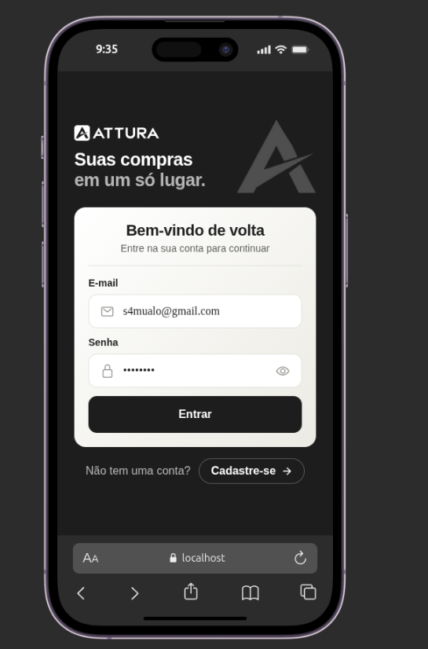
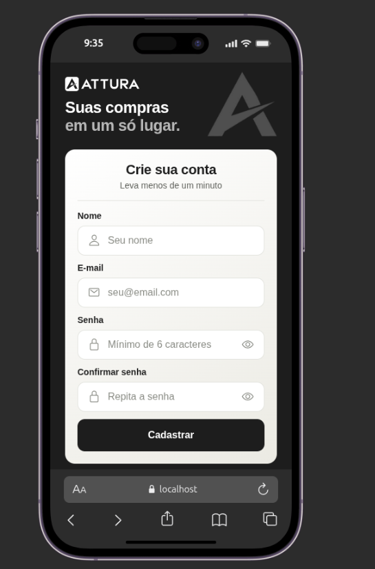
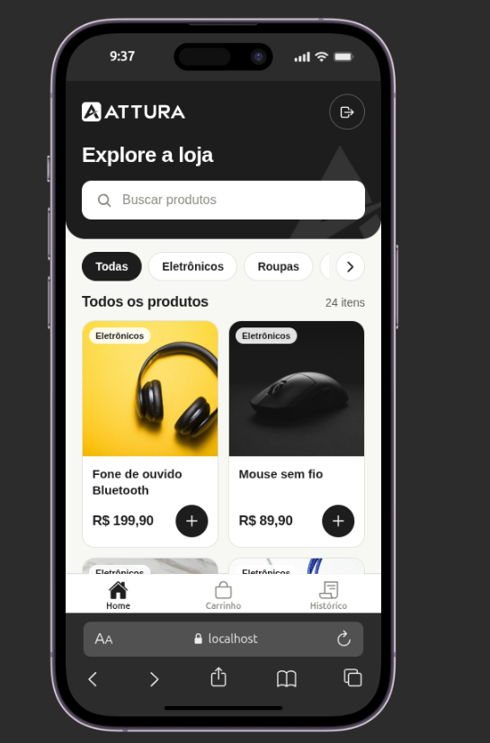
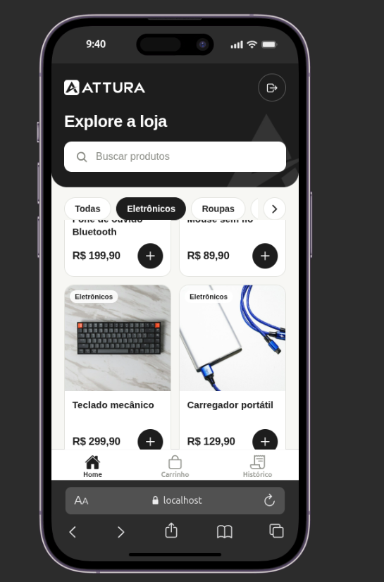
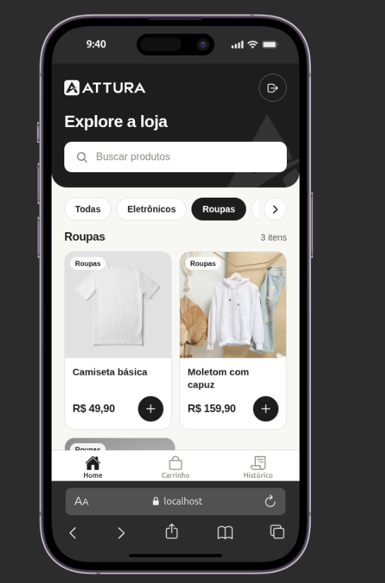
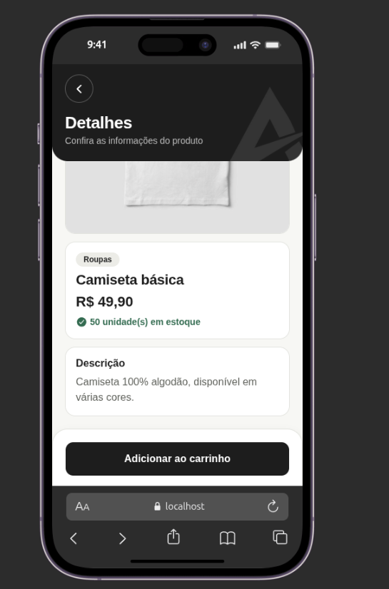
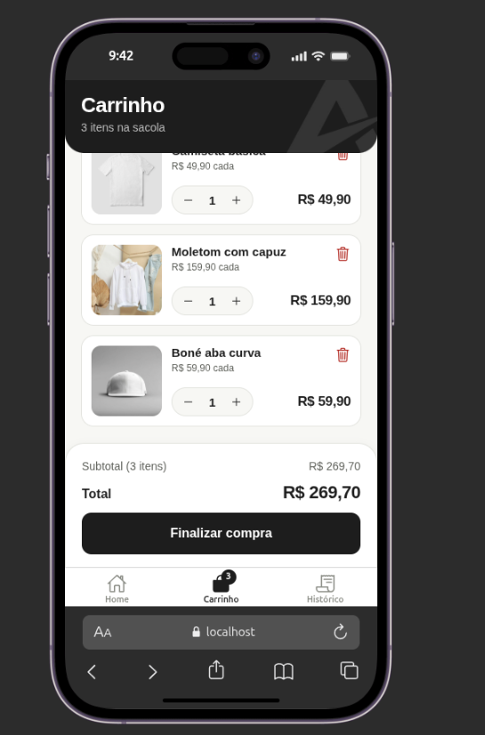
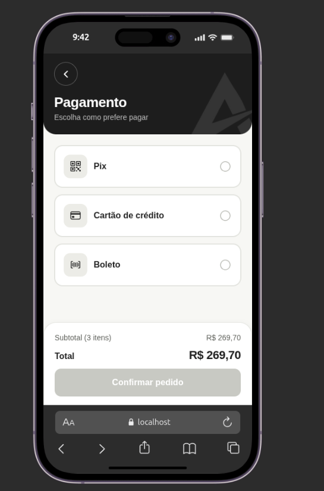
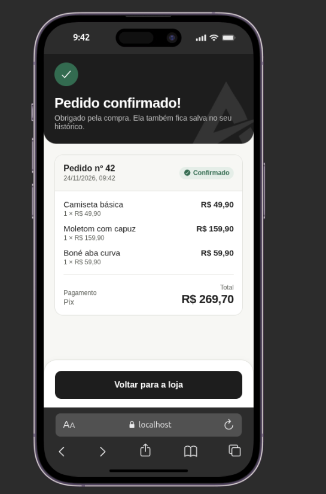
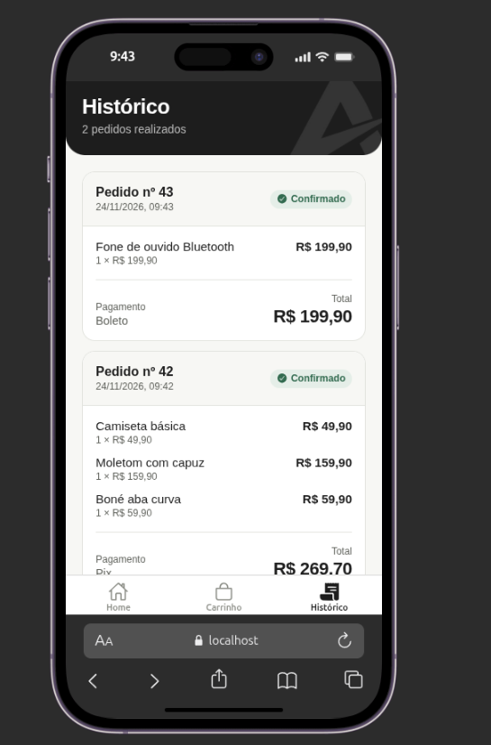

# ATTURA

ATTURA é uma loja virtual para celular onde o cliente cria a conta, encontra produtos por categoria ou busca, monta o carrinho e finaliza a compra em poucos toques.

Trabalho final de **Desenvolvimento de Aplicativos Móveis** — Prof. William Barrilli.

## Integrantes

- Samuel Aloísio De Bastiani
- Lucas de Lima

## Fluxo do app

Conta e login → catálogo → detalhes → carrinho → pagamento → pedido confirmado → histórico.

| Login | Cadastro | Catálogo |
| :---: | :---: | :---: |
|  |  |  |

| Filtro: Eletrônicos | Filtro: Roupas | Detalhes do produto |
| :---: | :---: | :---: |
|  |  |  |

| Carrinho | Pagamento | Pedido confirmado |
| :---: | :---: | :---: |
|  |  |  |

| Histórico |
| :---: |
|  |

## Funcionalidades

- **Conta e login:** cadastro com nome, e-mail e senha, login e logout pela API da loja (`POST /usuarios` e `POST /login`). Os campos são validados e os erros aparecem em português.
- **Sessão:** o token JWT fica salvo no aparelho; ao reabrir o app, o usuário continua logado. Se o token vencer, o app volta para o login.
- **Telas protegidas:** a loja só abre para usuários logados.
- **Catálogo:** lista de produtos com imagem, nome e preço em reais, filtro por categoria, busca por nome e tela de detalhes. Mostra carregamento e erro com opção de tentar de novo.
- **Carrinho:** adicionar, aumentar, diminuir (diminuir a partir de 1 remove o item) e remover. O total de itens aparece fixo no ícone da aba. Com o carrinho vazio, o botão de finalizar fica desativado. Erros da API, como estoque insuficiente, são mostrados ao usuário.
- **Pagamento:** formas de pagamento vindas da API (Pix, cartão e boleto); não é possível finalizar sem escolher uma.
- **Pedido confirmado:** número do pedido, itens e total; o carrinho volta vazio.
- **Histórico (extra):** lista das compras do usuário, vinda da API.

## Tecnologias

- React Native com Expo e TypeScript
- Expo Router (navegação baseada no React Navigation, com rotas tipadas)
- Axios para as chamadas à API
- AsyncStorage para guardar a sessão

## Como rodar o projeto

Pré-requisitos: Node.js instalado e o app **Expo Go** no celular (ou um emulador).

1. Clone o repositório e entre na pasta:

   ```bash
   git clone https://github.com/LucasLima09/ecommerce.git
   cd ecommerce
   ```

2. Instale as dependências:

   ```bash
   npm install
   ```

3. Crie o arquivo `.env` na raiz do projeto com a chave da API (a chave está no enunciado do trabalho):

   ```bash
   EXPO_PUBLIC_API_KEY=sua-chave-aqui
   ```

   O `.env` está no `.gitignore`, então a chave nunca vai para o repositório.

4. Inicie o projeto:

   ```bash
   npx expo start
   ```

5. Escaneie o QR code com o Expo Go (celular e computador na mesma rede Wi-Fi), ou aperte `a` para abrir no emulador Android.

## Organização do código

```
src/
├── app/          # telas (cada arquivo é uma rota do Expo Router)
│   ├── (auth)/   # login e cadastro
│   ├── (tabs)/   # Home (catálogo), Carrinho e Histórico
│   ├── produto/  # detalhes do produto
│   ├── pedido/   # confirmação do pedido
│   └── pagamento.tsx
├── api/          # cliente HTTP (axios) e sessão salva no aparelho
├── service/      # todas as chamadas à API, separadas por assunto
├── context/      # estado compartilhado: autenticação, carrinho e histórico
├── components/   # componentes reutilizáveis com props tipadas
├── types/        # tipos dos dados da API
├── theme/        # cores, espaçamentos e fontes do app
└── utils/        # formatação de preço e data, validações, mensagens de erro
```

- **Chamadas à API:** ficam todas em `src/service/`, nenhuma tela chama a API diretamente. O axios rejeita qualquer resposta fora de 2xx (o equivalente a conferir `resposta.ok`), e a mensagem do campo `erro` da API é mostrada ao usuário.
- **Token:** o `apiClient` envia `Authorization: Bearer <token>` em todas as chamadas, então as rotas de carrinho e compras não precisam de `usuarioId`.

## Por que Context API para o carrinho

O carrinho é usado em várias telas ao mesmo tempo: a Home (botão de adicionar), os detalhes do produto, a aba do carrinho, o contador fixo na barra de abas e a tela de pagamento. Com o **Context API** (`CarrinhoContext`), o carrinho fica em um único lugar e todas essas telas leem e atualizam o mesmo estado, sem precisar passar props de tela em tela.

Escolhemos o Context porque ele já vem com o React, não precisa de biblioteca extra e é suficiente para o tamanho do app. O mesmo padrão é usado para a autenticação (`AuthContext`) e para o histórico (`HistoricoContext`).
